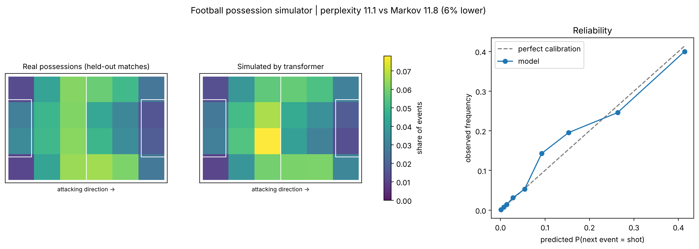

# ⚽ Football Possession Simulator

A small transformer (0.67M parameters) trained on [StatsBomb open data](https://github.com/statsbomb/open-data)
to **simulate football possessions event by event**, with an interactive app and built-in checks
that the simulation resembles real play.



*Left and middle: where events happen in real held-out possessions vs. simulated ones. Right: how well the model's
predicted probability of a shot matches reality.*

## What you can do with it

Pick a starting situation (for example "pass completed in the attacking box") and the model simulates thousands of
possessions from there. You get the probability of a shot or goal, where possessions tend to end, and example
sequences drawn on a pitch.

```bash
footballsim simulate --start-zone 20 --n 2000   # start in the attacking box -> ~33% of possessions end in a shot
footballsim simulate --start-zone 8  --n 2000   # start deeper in midfield   -> ~9%
```

## Quickstart

```bash
pip install -e ".[app,dev]"      # Python 3.10+
footballsim download             # StatsBomb World Cup 2018 + 2022 (~460k events, one minute)
footballsim train                # ~20-30 min on CPU, early stopping
footballsim evaluate             # held-out metrics, report.json and docs/hero.png
footballsim app                  # interactive web app
```

Other competitions: `footballsim download --competition "La Liga:2018/2019"` (any open StatsBomb competition,
repeatable). A trained checkpoint is included in `artifacts/`, so `footballsim app` works right after install.

## Results (held-out matches, 19 matches / 2,709 possessions never seen in training)

| | Markov baseline | Transformer |
|---|---|---|
| Perplexity (lower is better) | 11.78 | **11.08** (5.9% lower) |

| Simulated vs real possessions | Real | Simulated |
|---|---|---|
| Possessions with a shot | 12.6% | 12.9% |
| Possessions with a goal | 1.48% | 1.48% |
| Average length (events) | 10.6 | 11.1 |
| End in the final third | 47.3% | 50.8% |

**Honest reading of these numbers**
- The perplexity gain over a first-order Markov chain is **modest** (6%). Each token already contains
  the pitch zone, so the previous event carries most of the signal. The model's value is less in next-event accuracy
  than in generating realistic whole possessions and supporting "what if it starts here" queries.
- Shot and goal rates are reproduced closely, and predicted shot probabilities are well calibrated (right panel).
- The simulator drifts slightly: possessions are about 0.5 events too long, finish in the final third
  3.5 points too often, and over-weight central midfield zones
  (middle heatmap vs. left).

## How it works

1. **Tokens.** Each event becomes `Action_Outcome_Zone`, for example `Pass_ok_z8`, on a 6x4 pitch grid. A possession is a
   sequence of such tokens (2 to 38 events).
2. **Model.** A decoder-only transformer (3 layers, 4 heads, d=128) learns to predict the next token.
3. **Evaluation.** Train/validation/test are split **by match**, so no match leaks across splits. The vocabulary is built
   from training matches only. Perplexity is compared with a smoothed Markov baseline on the same test possessions.
4. **Simulation.** Possessions are sampled token by token, optionally from a fixed starting token, with a temperature control.

## Project layout

```
src/footballsim/   data.py (download + tokenization), vocab.py, model.py, train.py,
                   simulate.py, evaluate.py, plotting.py, cli.py
app/streamlit_app.py   interactive app
tests/                 18 unit tests (causality, split leakage, simulation, plots, checkpoints)
artifacts/             trained checkpoint, report and cached data
```

Development: `make test`, `make lint`. CI runs both on every push (`.github/workflows/ci.yml`).

## Limitations

- About 128 World Cup matches: small, tournament football only, so goal rates are noisy and style effects are limited.
- No team, player, score or minute context, so the model describes an average possession, not a specific team.
- Coarse 6x4 zones; events only (no tracking or off-ball data).
- Possessions can continue after a shot (for example a rebound), which the model reproduces.

## Roadmap

- Condition on team and lineup, then estimate **player-swap counterfactuals**, validated against real substitutions with
  placebo tests and uncertainty intervals before making any claim.
- Train on more seasons and compare against stronger baselines (higher-order Markov, gradient boosting).
- Add error bars (multiple seeds) to every reported metric.

## License

MIT. Data: StatsBomb open data, used under its [terms](https://github.com/statsbomb/open-data/blob/master/LICENSE.pdf);
please credit StatsBomb if you publish results.
